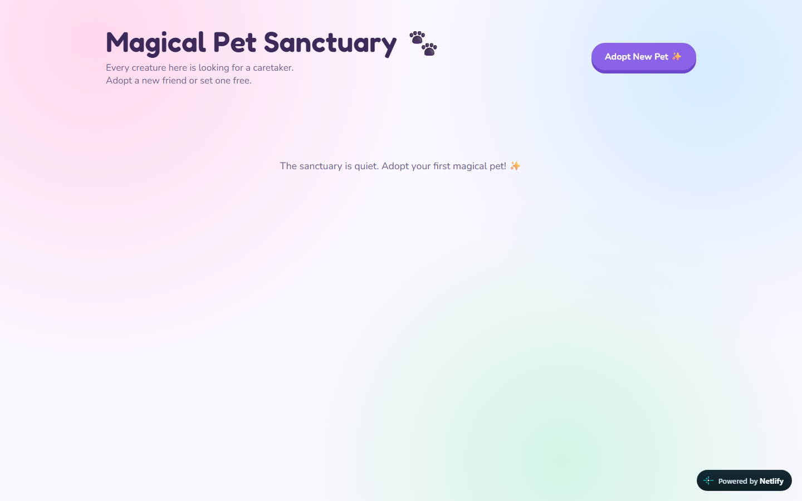
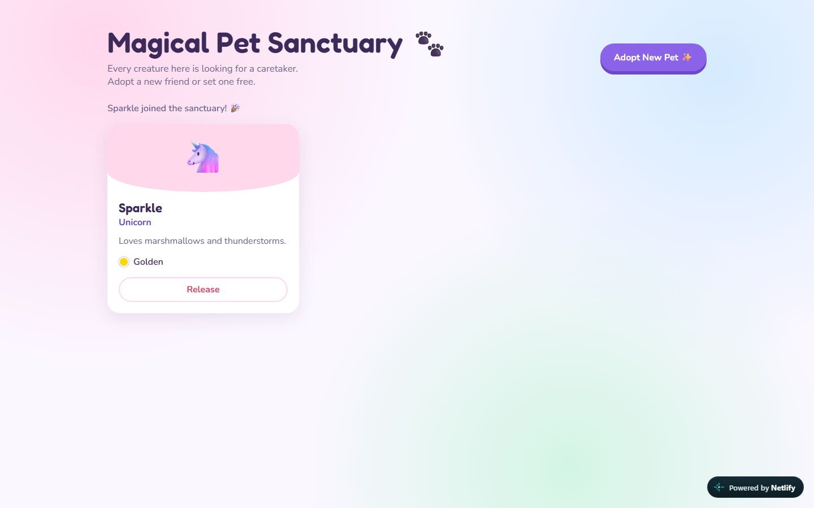
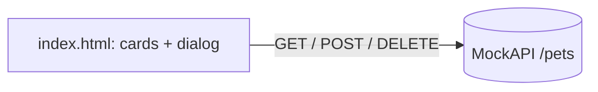

# Magical Pet Sanctuary

A playful single-page app to adopt magical pets and set them free again. Plain HTML, CSS and JavaScript talking to a REST API with `fetch` and `async/await`.


| | |
|---|---|
|  |  |

## Features

- Lists the pets from the API as cards.
- "Adopt New Pet" dialog with validation (name, type, colour, description).
- Release a pet (DELETE) with live status messages.
- Accessible: labelled dialog, `aria-live` status, focus styles, reduced-motion support.

## Architecture



## Tech stack

| Layer | Technology |
|---|---|
| UI | HTML5, CSS3 (variables, gradients, animations) |
| Logic | Vanilla JavaScript, `fetch` + `async/await` |
| Data | MockAPI.io REST endpoint (a shared, public sandbox) |

## Quick start

No build step. Open `index.html` in a browser, or:

```bash
npx serve .
```

## Tests

No automated tests. Checked with Playwright against the deployed page (since taken down): the page loads with no console errors at 1440 px and 375 px, and adopting then releasing a pet works.

## Security notes

The page contains no secrets. The data lives in a public MockAPI sandbox, so do not enter anything personal.

## Roadmap

- Edit an existing pet (PUT).
- Replace the shared sandbox with a small API of its own.
